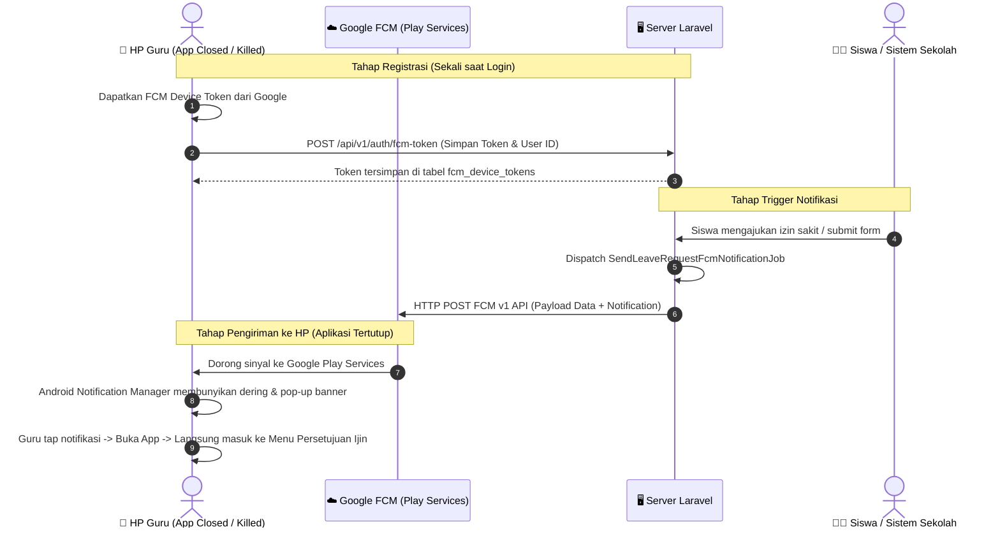

# 📋 Blueprint Teknis: Push Notification FCM (Firebase Cloud Messaging)

Dokumen ini merupakan **Panduan Komprehensif & Rencana Kerja Terstruktur (Tahap 1 s.d. Tahap 6)** untuk menerapkan sistem notifikasi **Push Notification FCM (Firebase Cloud Messaging)** pada aplikasi mobile Flutter (`apk-android-presensi`) dan backend Laravel (`projek-absensi-barcode`).

Fitur ini memungkinkan notifikasi penting (seperti permohonan izin siswa, pengumuman, atau pembaruan presensi) masuk secara instan ke HP pengguna dengan suara dan banner layaknya WhatsApp, **meskipun aplikasi sedang ditutup total (*killed/closed state*) atau layar HP dalam kondisi terkunci**.

---

## 1. Arsitektur & Cara Kerja Push Notification (Killed/Background State)



### Mengapa Notifikasi Bisa Masuk Saat Aplikasi Ditutup (*Killed*)?
1. **Google Play Services**: Sistem Android memiliki proses sistem inti bawaan Google yang selalu mempertahankan koneksi soket TCP ringan ke server Google.
2. **System Tray Notification**: Ketika Google FCM mengirimkan payload bertipe `notification`, sistem Android (bukan aplikasi kita) yang bertugas menggambar banner di status bar dan memutar suara dering.
3. **Low Battery Impact**: Aplikasi kita tidak perlu menyala terus-menerus di background, sehingga baterai HP pengguna tetap sangat hemat dan tidak dibunuh oleh task killer Android.
4. **Deep-linking On-Tap**: Saat banner notifikasi di-tap oleh guru, aplikasi akan dibuka secara otomatis dan kode Flutter kita akan membaca payload data untuk langsung membuka layar yang bersangkutan.

---

## 2. Inventarisasi & Evaluasi Sistem Saat Ini

### A. Kondisi Backend Laravel (`projek-absensi-barcode`):
- ✅ **Database Migration**: Tabel `fcm_device_tokens` sudah tersedia (`database/migrations/2026_10_29_213500_create_fcm_device_tokens_table.php`) lengkap dengan kolom `user_id`, `token`, `platform`, `device_name`, dan `last_used_at`.
- ✅ **Model Eloquent**: Model `App\Models\FcmDeviceToken` sudah tersedia dan terhubung ke `User`.
- ✅ **API Endpoints**: 
  - `POST /api/v1/auth/fcm-token` (Pendaftaran / pembaruan token perangkat).
  - `DELETE /api/v1/auth/fcm-token` (Pembersihan token saat logout).
- ⚠️ **Upgrade Diperlukan**: Meng-upgrade job `SendLeaveRequestFcmNotificationJob` dari API legacy (`fcm.googleapis.com/fcm/send`) ke **FCM HTTP v1 API** (`fcm.googleapis.com/v1/projects/{project_id}/messages:send`) menggunakan *Service Account Private Key JSON*, karena Google telah resmi mendepresiasi API legacy.

### B. Kondisi Mobile Flutter (`apk-android-presensi`):
- ⚠️ **Belum Ada Dependensi Firebase**: Perlu menambahkan `firebase_core`, `firebase_messaging`, dan `flutter_local_notifications`.
- ⚠️ **Belum Ada Konfigurasi Native Android**: Perlu mendaftarkan Google Services Gradle Plugin di `android/build.gradle.kts` dan `android/app/build.gradle.kts`.
- ⚠️ **File `google-services.json`**: Perlu diunduh dari Firebase Console dan ditempatkan di `android/app/google-services.json`.
- ⚠️ **Izin Android 13+**: Perlu mendaftarkan izin `POST_NOTIFICATIONS` di `AndroidManifest.xml` serta *runtime permission prompt*.
- ⚠️ **Background Handler**: Perlu membuat fungsi top-level bertanda `@pragma('vm:entry-point')` untuk menangani notifikasi saat aplikasi mati.

---

## 3. Rencana Kerja Bertahap (Tahap 1 s.d. Tahap 6)

### 🔹 Tahap 1: Setup Proyek Firebase & Konfigurasi Android Native
- **Persiapan Firebase Console**:
  - Membuat / mendaftarkan aplikasi Android dengan Package Name: `id.haflaitsolution.apk_portal_smpn1_sampang`.
  - Mengunduh file konfigurasi `google-services.json`.
  - Meletakkan `google-services.json` ke dalam direktori `apk-android-presensi/android/app/`.
- **Konfigurasi Gradle (Kotlin DSL)**:
  - Menambahkan dependensi classpath Google Services di `android/build.gradle.kts`:
    ```kotlin
    plugins {
        id("com.google.gms.google-services") version "4.4.2" apply false
    }
    ```
  - Menerapkan plugin di `android/app/build.gradle.kts`:
    ```kotlin
    plugins {
        id("com.android.application")
        id("dev.flutter.flutter-gradle-plugin")
        id("com.google.gms.google-services")
    }
    ```
- **Konfigurasi `AndroidManifest.xml`**:
  - Menambahkan izin `android.permission.POST_NOTIFICATIONS`.
  - Menambahkan izin `android.permission.VIBRATE`.
  - Menambahkan default notification icon dan channel ID di dalam tag `<application>`.

---

### 🔹 Tahap 2: Instalasi Dependencies Flutter & Background Entry Point
- **Menambahkan Dependensi di `pubspec.yaml`**:
  - `firebase_core: ^3.6.0`
  - `firebase_messaging: ^15.1.3`
  - `flutter_local_notifications: ^17.2.2`
- **Konfigurasi `main.dart`**:
  - Memanggil `WidgetsFlutterBinding.ensureInitialized()`.
  - Menginisialisasi Firebase: `await Firebase.initializeApp()`.
  - Mendaftarkan fungsi background message handler top-level:
    ```dart
    @pragma('vm:entry-point')
    Future<void> _firebaseMessagingBackgroundHandler(RemoteMessage message) async {
      await Firebase.initializeApp();
      // Penanganan payload latar belakang saat aplikasi killed
    }
    ```
  - Memanggil `FirebaseMessaging.onBackgroundMessage(_firebaseMessagingBackgroundHandler)`.

---

### 🔹 Tahap 3: Service FCM Mobile & Sinkronisasi Token Otomatis
- **Membuat `lib/core/services/fcm_service.dart`**:
  - Metode `initialize()`:
    - Meminta izin notifikasi runtime Android 13+ (`FirebaseMessaging.instance.requestPermission()`).
    - Membuat Android Notification Channel berkategori `High Importance` (dengan suara dan getaran).
    - Inisialisasi plugin `flutter_local_notifications` untuk menampilkan banner saat aplikasi sedang dibuka (*Foreground*).
  - Metode `syncDeviceToken(String authToken)`:
    - Mengambil token perangkat: `await FirebaseMessaging.instance.getToken()`.
    - Mengirim token ke backend: `POST /api/v1/auth/fcm-token` dengan platform `'android'` dan nama perangkat.
  - Listener `FirebaseMessaging.instance.onTokenRefresh`:
    - Otomatis mengirimkan token baru ke backend jika Google memperbarui token perangkat.
  - Integrasi saat Logout:
    - Memanggil `DELETE /api/v1/auth/fcm-token` saat user menekan Logout di Profil Guru maupun Siswa agar token lama terhapus dari server.

---

### 🔹 Tahap 4: Handling Interaksi Notifikasi & Deep Linking
- **Menangani 3 Skenario Kondisi Aplikasi**:
  1. **Aplikasi Tertutup / Killed State**:
     - Menggunakan `FirebaseMessaging.instance.getInitialMessage()`.
     - Jika aplikasi dibuka akibat pengguna menekan banner notifikasi, sistem langsung mengekstrak payload data dan melakukan navigasi ke menu terkait setelah halaman utama terpasang.
  2. **Aplikasi di Latar Belakang (Background / Minimized)**:
     - Menggunakan listener `FirebaseMessaging.onMessageOpenedApp.listen((message) { ... })`.
     - Langsung memicu navigasi `Navigator.pushNamed(...)` atau rute tujuan.
  3. **Aplikasi Sedang Terbuka (Foreground)**:
     - Menggunakan listener `FirebaseMessaging.onMessage.listen((message) { ... })`.
     - Menampilkan banner notifikasi lokal di bagian atas layar via `flutter_local_notifications` dengan suara lembut agar pengguna tetap tahu ada pesan baru tanpa terganggu.
- **Dukungan Tipe Payload Navigasi**:
  - `'type': 'leave_request'` -> Membuka `PersetujuanIjinScreen`.
  - `'type': 'spikap_violation'` -> Membuka `SpikapScreen`.
  - `'type': 'jurnal_reminder'` -> Membuka `JurnalMengajarScreen`.
  - `'type': 'announcement'` -> Membuka dialog pengumuman.

---

### 🔹 Tahap 5: Upgrade Backend Laravel ke FCM HTTP v1 & Notifikasi Otomatis
- **Penerapan FCM HTTP v1 API**:
  - Google mengharuskan autentikasi OAuth2 menggunakan berkas JSON Service Account (`firebase-service-account.json`).
  - Membuat class `App\Services\FcmService`:
    - Menghasilkan access token Google OAuth2 berumur 1 jam secara otomatis.
    - Mengirim pesan ke endpoint `https://fcm.googleapis.com/v1/projects/{project_id}/messages:send`.
- **Integrasi Triggers Otomatis di Laravel**:
  - **Permohonan Izin Siswa**:
    - Saat siswa mengirim izin via aplikasi, controller men-dispatch `SendLeaveRequestFcmNotificationJob`.
    - Server mencari data wali kelas siswa tersebut, mengambil seluruh FCM Token aktif milik wali kelas, dan mengirimkan push notification.
  - **Keputusan Izin oleh Wali Kelas**:
    - Saat wali kelas menyetujui atau menolak izin, server mengirimkan notifikasi balik ke perangkat siswa/orang tua siswa.
  - **Pencatatan Pelanggaran SPIKAP**:
    - Notifikasi instan kepada wali kelas siswa yang bersangkutan saat ada pelanggaran baru dicatat.
- **Endpoint Pengujian / Test Notification**:
  - Menyediakan endpoint / artisan command `php artisan fcm:test {user_id}` untuk mempermudah developer melakukan uji coba pengiriman ke perangkat tertentu tanpa harus memicu event sungguhan.

---

### 🔹 Tahap 6: Pengujian End-to-End, Troubleshooting HP & Finalisasi
- **Matriks Pengujian Menyeluruh**:
  1. *Test 1*: Kirim notif saat aplikasi Foreground -> Banner pop-up lokal muncul.
  2. *Test 2*: Kirim notif saat aplikasi Background (di-minimize) -> Notifikasi status bar muncul, di-tap aplikasi membuka menu target.
  3. *Test 3*: Kirim notif saat aplikasi Killed/Closed (di-swipe kill dari recent apps, layar mati) -> HP berdering, status bar menampilkan notifikasi, di-tap membuka aplikasi.
  4. *Test 4*: Ganti akun / Logout -> Token dihapus dari database backend sehingga tidak menerima notifikasi akun sebelumnya.
- **Panduan Kompatibilitas Vendor Android (MIUI / ColorOS / Funtouch / OneUI)**:
  - Menyiapkan panduan izin *Auto-start* dan *Battery Optimization Unrestricted* untuk HP Xiaomi/Oppo/Vivo jika pengguna mengeluhkan notifikasi tertahan oleh penghemat baterai agresif vendor.
- **Verifikasi Static Analysis & Git Push**:
  - Memastikan `analyze_files` 0 error.
  - Git commit dan push ke kedua repositori GitHub.

---

## 4. Panduan Persiapan untuk Pemilik Proyek (Prasyarat)

Untuk mengeksekusi fitur ini nanti, diperlukan 2 berkas konfigurasi dari **Firebase Console**:

1. **`google-services.json`** (Untuk Aplikasi Mobile Flutter):
   - Masuk ke [Firebase Console](https://console.firebase.google.com/).
   - Buat project baru (misal: `Portal Presensi Sekolah`).
   - Tambahkan aplikasi **Android**, masukkan Package Name: `id.haflaitsolution.apk_portal_smpn1_sampang`.
   - Unduh file `google-services.json` dan letakkan di `apk-android-presensi/android/app/`.

2. **`service-account.json`** (Untuk Server Backend Laravel):
   - Di Firebase Console, buka **Project Settings > Service accounts**.
   - Klik **Generate new private key** dan simpan file JSON-nya.
   - Letakkan di server Laravel pada folder `projek-absensi-barcode/storage/app/firebase/service-account.json`.

*(Catatan: Langkah pembuatan file ini dapat dipandu secara langsung saat kita mulai mengeksekusi Tahap 1).*

---

## 5. Status Rencana Eksekusi
- [ ] **Tahap 1: Setup Proyek Firebase & Konfigurasi Android Native**
- [ ] **Tahap 2: Instalasi Dependencies Flutter & Background Entry Point**
- [ ] **Tahap 3: Service FCM Mobile & Sinkronisasi Token Otomatis**
- [ ] **Tahap 4: Handling Interaksi Notifikasi & Deep Linking**
- [ ] **Tahap 5: Upgrade Backend Laravel ke FCM HTTP v1 & Triggers**
- [ ] **Tahap 6: Pengujian End-to-End, Troubleshooting HP & Finalisasi**
