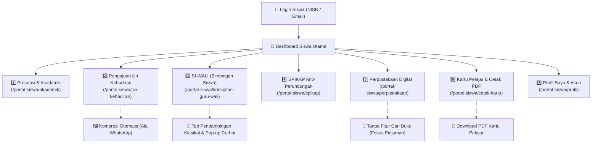

# 🎓 Master Plan: Portal Siswa & Akun Pelajar Mobile

Dokumen ini merupakan **Grand Design & Blueprint Arsitektur Master** untuk pengembangan modul **Portal Siswa** pada aplikasi mobile Flutter (`apk-android-presensi`) dan backend Laravel (`projek-absensi-barcode`).

Mengacu pada portal web resmi siswa (`http://localhost:8001/portal-siswa/*`), modul ini dirancang ramah pelajar (mobile-first, modern, responsif, hemat kuota) dengan **7 Menu Utama**.

---

## 🗺️ Peta 7 Menu Utama Portal Siswa



---

## 1. Spesifikasi Fungsional 7 Menu Portal Siswa

### 1️⃣ Menu 1: Presensi & Kalender Akademik Siswa
* **Rujukan Web**: `http://localhost:8001/portal-siswa/akademik`
* **Komponen Livewire**: `App\Livewire\SiswaDashboard`
* **Fitur Utama di Mobile**:
  - **Status Presensi Hari Ini**: 
    - Jam Scan Masuk & Status: *Tepat Waktu* (hijau) atau *Terlambat* (kuning, beserta durasi menit).
    - Jam Scan Pulang (jika fitur checkout aktif).
    - Status Ibadah Sholat Dhuhur Hari Ini (*Berjamaah*, *Masbuk*, *Halangan/Haid*, *Belum*).
  - **Ringkasan Kehadiran Bulanan**:
    - Kartu Statistik: Total Masuk (Hadir), Terlambat, Sakit, Izin, Alpha.
    - Persentase Tingkat Kehadiran Bulanan (`%`).
  - **Matriks Kalender Kehadiran (Grid Tanggal 1 s/d 31)**:
    - Dot warna status per hari (Hijau: Hadir, Kuning: Terlambat, Biru: Izin/Sakit, Merah: Alpha, Abu-abu: Libur).
    - Filter bulan & tahun ajaran aktif.

---

### 2️⃣ Menu 2: Pengajuan Ijin Kehadiran (Online Form + Kompresi Foto)
* **Rujukan Web**: `http://localhost:8001/portal-siswa/ijin-kehadiran` dan `/form`
* **Komponen Livewire**: `App\Livewire\PortalSiswa\IjinKehadiranList` & `IjinKehadiranForm`
* **Fitur Utama di Mobile**:
  - **Daftar Riwayat Izin**:
    - Menampilkan seluruh permohonan izin/sakit dengan badge status: `Menunggu Verifikasi (Pending)`, `Disetujui (Approved)`, atau `Ditolak (Rejected)`.
    - Riwayat catatan verifikasi dari Wali Kelas jika ditolak/disetujui.
  - **Formulir Pengajuan Baru**:
    - Pilihan Kategori: **Sakit** (wajib lampiran surat dokter/ortu) atau **Izin** (surat keterangan).
    - Pemilih Tanggal Rentang: Tanggal Mulai s/d Tanggal Selesai (durasi hari otomatis dihitung, skip hari libur/minggu).
    - Alasan / Keterangan tertulis.
  - **Fitur Khusus Kompresi Foto Otomatis (Ala WhatsApp)**:
    - Siswa dapat mengambil foto surat dokter melalui Kamera atau Galeri.
    - Sebelum diunggah ke server, aplikasi Flutter otomatis melakukan kompresi resolusi (maksimal lebar/tinggi 1280px) dan kompresi kualitas gambar (quality 70%) sehingga ukuran berkas dari 5MB–10MB menjadi ~150KB–300KB secara instan.
    - Menghemat kuota internet siswa dan mempercepat respon kirim berkas.

---

### 3️⃣ Menu 3: SI-WALI (Konsultasi Guru Wali & Bimbingan Klasikal)
* **Rujukan Web**: `http://localhost:8001/portal-siswa/konsultasi-guru-wali`
* **Komponen Livewire**: `App\Livewire\PortalSiswa\KonsultasiGuruWaliList`
* **Fitur Utama di Mobile**:
  - **Header Guru Wali**: Menampilkan identitas Guru Wali asuh siswa (Foto, Nama, NIP, Tombol Chat WA Cepat).
  - **Sistem Tab Navigasi**:
    - **Tab 1: Bimbingan Mandiri (Curhat Saya)**: Riwayat konsultasi yang diajukan siswa (status: Menunggu Respon, Terjadwal, Selesai, Ditolak).
    - **Tab 2: Pendampingan Klasikal & Kelompok**: Informasi materi, pengumuman, atau catatan bimbingan kelas yang dibagikan guru wali kepada seluruh siswa binaan atau kelompok belajar.
  - **Pop-up / Modal "Bercerita ke Guru Wali"**:
    - Formulir dialog elegan & ramah anak untuk mencurahkan isi hati/kendala.
    - Pilihan Kategori: *Akademik*, *Karakter & Kedisiplinan*, *Minat & Bakat / Ekskul*, *Sosial & Psikologis*.
    - Pilihan Mode: *Tatap Muka* atau *Pesan Rahasia Portal*.
    - Field usulan tanggal/waktu pertemuan santai.
  - **Fitur Obrolan & Feedback Emotikon**:
    - Siswa dapat membalas pesan dari guru wali di dalam detail tiket bimbingan.
    - Memberikan rating kepuasan (emotikon) setelah konsultasi selesai.

---

### 4️⃣ Menu 4: SPIKAP (Sistem Informasi Karakter & Anti-Perundungan)
* **Rujukan Web**: `http://localhost:8001/portal-siswa/spikap` dan `/form`
* **Komponen Livewire**: `App\Livewire\PortalSiswa\SpikapLaporanList` & `SpikapLaporanForm`
* **Fitur Utama di Mobile**:
  - **Tab 1: Laporan Pengaduan Saya**:
    - Riwayat laporan yang dikirim siswa beserta status investigasi tim penanganan sekolah (Menunggu, Diproses, Selesai).
    - Kerahasiaan identitas terjamin.
  - **Tab 2: Catatan Karakter / Pelanggaran Saya**:
    - Informasi transparan buku saku karakter siswa (poin pelanggaran atau catatan pembinaan dari guru BK/Kesiswaan jika ada).
  - **Formulir Lapor SPIKAP (Aman & Nyaman)**:
    - Opsi Kirim Sebagai: **Identitas Asli** atau **Anonim (Rahasia Penuh)**.
    - Pilihan Kategori: *Perundungan Fisik*, *Perundungan Verbal*, *Cyberbullying*, *Pemalakan/Pemerasan*, *Lainnya*.
    - Uraian kronologi kejadian, tempat, waktu, dan pelaku/korban.
    - Lampiran bukti foto/tangkapan layar.

---

### 5️⃣ Menu 5: Perpustakaan Digital Siswa (Tanpa Fitur Pencarian)
* **Rujukan Web**: `http://localhost:8001/portal-siswa/perpustakaan`
* **Komponen Livewire**: `App\Livewire\SiswaPerpustakaan`
* **Fitur Utama di Mobile**:
  - *(Catatan Khusus Sesuai Arahan: Pencarian Katalog Buku ditiadakan, fokus pada transaksi siswa)*.
  - **Tab 1: Peminjaman Aktif**:
    - Daftar buku yang sedang dipinjam siswa.
    - Informasi Tanggal Pinjam, Tanggal Jatuh Tempo (Batas Pengembalian).
    - Indikator peringatan visual jika pinjaman mendekati batas waktu atau terlambat (*overdue*).
  - **Tab 2: Riwayat Peminjaman**:
    - Histori seluruh buku yang pernah dibaca dan telah dikembalikan siswa.
  - **Tab 3: Riwayat Kunjungan**:
    - Rekap jumlah dan tanggal kunjungan fisik siswa ke perpustakaan sekolah.

---

### 6️⃣ Menu 6: Kartu Pelajar Digital & Unduh PDF
* **Rujukan Web**: `http://localhost:8001/portal-siswa/cetak-kartu`
* **Controller Backend**: `App\Http\Controllers\SiswaCetakController::cetakKartuMandiri`
* **Fitur Utama di Mobile**:
  - **Tampilan Kartu Pelajar Digital Interaktif**:
    - Desain kartu ID resmi sekolah (Logo sekolah, Foto siswa, Nama, NISN/NIS, Kelas).
    - **Barcode Code 128 Native**: Dihasilkan presisi menggunakan `barcode_widget` dari string NISN/Barcode ID untuk discan langsung oleh scanner gerbang/perpustakaan.
    - Mode Layar Penuh (Landscape & Kecerahan Maksimum) untuk memudahkan pemindaian.
  - **Fitur Unduh / Cetak PDF**:
    - Tombol aksi *"Unduh Kartu PDF"* yang langsung mengunduh berkas PDF kartu beresolusi cetak tinggi ke penyimpanan HP siswa atau membukanya via browser/PDF viewer.

---

### 7️⃣ Menu 7: Profil Saya & Akun Pelajar
* **Rujukan Web**: `http://localhost:8001/portal-siswa/profil`
* **Komponen Livewire**: `App\Livewire\SiswaProfil`
* **Fitur Utama di Mobile**:
  - **Hero Header Pelajar**: Avatar foto resmi, NISN, status keanggotaan aktif, rombel kelas.
  - **Tab 1: Biodata & Kontak**:
    - Data Akademik: NIK, Tempat/Tanggal Lahir, Jenis Kelamin, Agama, Nama Ayah/Ibu.
    - Pengkinian Alamat Tempat Tinggal dan Nomor HP/WhatsApp aktif.
    - Unggah / Ganti Foto Profil siswa (jika diizinkan oleh kebijakan sekolah).
  - **Tab 2: Keamanan Akun & Sandi**:
    - Formulir ganti kata sandi login (Kata Sandi Lama, Kata Sandi Baru minimal 8 karakter, Konfirmasi Sandi dengan toggle show/hide).
  - **Tombol Keluar Akun (Logout)** dengan dialog konfirmasi aman.

---

## 2. Arsitektur REST API Backend Siswa (`/api/v1/siswa/*`)

Untuk menopang 7 menu mobile tersebut, backend Laravel menyediakan endpoint modular khusus siswa:

```
/api/v1/siswa/
├── dashboard                    [GET]  Ringkasan hadir hari ini, sholat, kartu cepat
├── akademik/
│   ├── dashboard                [GET]  Statistik bulanan & kalender kehadiran 1-31
│   └── riwayat                  [GET]  Daftar log presensi per bulan
├── ijin-kehadiran/
│   ├── list                     [GET]  Daftar riwayat izin siswa
│   ├── submit                   [POST] Pengajuan izin baru + upload lampiran
│   └── detail/{id}              [GET]  Detail izin & feedback wali kelas
├── guru-wali/
│   ├── info                     [GET]  Data guru wali asuh & kontak WA
│   ├── konsultasi               [GET]  Daftar tiket konsultasi siswa
│   ├── konsultasi/store         [POST] Kirim curhat/bimbingan baru
│   ├── konsultasi/{id}/chat     [POST] Kirim balasan pesan
│   ├── konsultasi/{id}/feedback [POST] Beri emotikon rating
│   └── klasikal                 [GET]  Daftar pendampingan kelompok/kelas
├── spikap/
│   ├── list                     [GET]  Riwayat laporan & catatan poin karakter
│   └── store                    [POST] Kirim laporan anti-perundungan baru
├── perpustakaan/
│   ├── pinjaman-aktif           [GET]  Buku yang sedang dipinjam
│   ├── riwayat-pinjam           [GET]  Histori buku yang pernah dipinjam
│   └── riwayat-kunjungan        [GET]  Histori kunjungan fisik
├── kartu/
│   ├── digital-info             [GET]  Data identitas & barcode string
│   └── download-pdf             [GET]  URL download berkas PDF kartu siswa
└── profil/
    ├── info                     [GET]  Biodata lengkap & akun
    ├── update-kontak            [POST] Update alamat & no HP
    ├── update-foto              [POST] Upload foto siswa
    └── update-password          [POST] Ubah kata sandi akun
```

---

## 3. Rencana Kerja Bertahap (Tahap 1 s.d. Tahap 7)

| Tahap | Modul / Menu | Cakupan Pekerjaan Utama |
| :---: | :--- | :--- |
| **Tahap 1** | **Backend REST API Modular Siswa & Dashboard Utama** | Setup Controller API Siswa di Laravel, struktur route `/api/v1/siswa/*`, refactoring `DashboardSiswaScreen` di Flutter dengan grid 7 menu + kartu cepat. |
| **Tahap 2** | **Menu 1: Presensi & Kalender Akademik** | Tampilan status hadir/terlambat hari ini, sholat dhuhur, rekap persentase, dan kalender grid 1-31. |
| **Tahap 3** | **Menu 2: Pengajuan Ijin Kehadiran + Kompresi Foto** | Riwayat izin, form pengajuan, integrasi `image_picker` + **kompresi otomatis gambar (ala WA)** sebelum dikirim via multipart. |
| **Tahap 4** | **Menu 3: SI-WALI (Bimbingan Siswa & Klasikal)** | Info Guru Wali, Tab Konsultasi Mandiri (Pop-up Curhat ke Guru Wali), Tab Pendampingan Klasikal/Kelompok, dan obrolan pesan. |
| **Tahap 5** | **Menu 4: SPIKAP & Menu 5: Perpustakaan** | Menu 4: SPIKAP Lapor Anti-Perundungan (opsi anonim) & riwayat poin.<br>Menu 5: Perpustakaan (hanya pinjaman aktif & riwayat, tanpa cari buku). |
| **Tahap 6** | **Menu 6: Kartu Pelajar Barcode & Download PDF** | Tampilan kartu barcode Code 128 interaktif full-screen high-contrast + tombol download berkas PDF kartu siswa. |
| **Tahap 7** | **Menu 7: Profil Saya, Finalisasi & Testing** | Layar profil biodata, ganti sandi, logout, validasi static analysis 0 error, dan git push origin main. |

---

## 4. Status Eksekusi Bertahap
- [x] **Tahap 1: Backend REST API Modular Siswa & Dashboard Utama** (Selesai ✅)
- [x] **Tahap 2: Menu 1 - Presensi & Kalender Akademik Siswa** (Selesai ✅)
- [x] **Tahap 3: Menu 2 - Pengajuan Ijin Kehadiran & Kompresi Foto WA** (Selesai ✅)
- [ ] **Tahap 4: Menu 3 - SI-WALI Siswa & Pendampingan Klasikal** (Sedang Dikerjakan 🚀)
- [ ] **Tahap 5: Menu 4 - SPIKAP & Menu 5 - Perpustakaan (Tanpa Search)**
- [ ] **Tahap 6: Menu 6 - Kartu Pelajar Digital Barcode & Download PDF**
- [ ] **Tahap 7: Menu 7 - Profil Saya, Finalisasi & Testing Terpadu**
