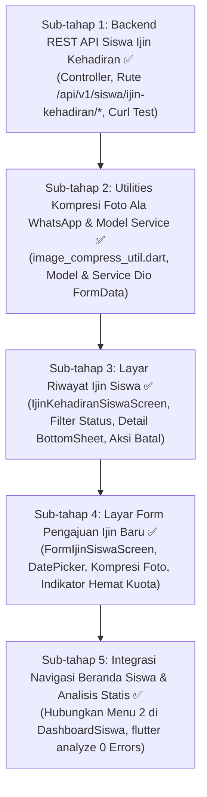

# 📋 Plan Menu 2: Pengajuan Ijin Kehadiran & Kompresi Foto Otomatis (Ala WhatsApp) - [SELESAI 100%]

Dokumen ini merupakan panduan implementasi teknis untuk **Menu 2: Pengajuan Ijin Kehadiran** pada Portal Siswa aplikasi mobile Flutter (`apk-android-presensi`) dan backend Laravel (`projek-absensi-barcode`).

Mengacu pada portal web resmi:
* Rujukan List: `http://localhost:8001/portal-siswa/ijin-kehadiran` (`App\Livewire\PortalSiswa\IjinKehadiranList`)
* Rujukan Form: `http://localhost:8001/portal-siswa/ijin-kehadiran/form` (`App\Livewire\PortalSiswa\IjinKehadiranForm`)

---

## 🚀 Fitur Utama & Kebutuhan Khusus

1. **Daftar Riwayat Izin Siswa**:
   * Filter badge status: Semua, Menunggu Verifikasi (*Pending*), Disetujui (*Approved*), Ditolak (*Rejected*).
   * Filter badge tipe: Semua Kategori, Sakit, Izin.
   * Menampilkan rentang tanggal (Mulai s.d. Selesai), total durasi hari, alasan, dan catatan dari Wali Kelas jika disetujui/ditolak.
   * Siswa dapat membatalkan pengajuan yang masih berstatus *Pending*.
2. **Formulir Pengajuan Ijin Baru**:
   * Pilihan Kategori: **Sakit** (wajib lampiran bukti surat dokter/ortu) atau **Izin** (surat izin).
   * Pemilih Tanggal Mulai dan Durasi Hari (Tanggal Selesai otomatis dihitung).
   * Deteksi Hari Libur otomatis via `KalenderSekolahService`.
   * Input teks alasan / keterangan tertulis.
3. **Fitur Khusus Kompresi Foto Otomatis (Ala WhatsApp)**:
   * Siswa mengambil foto surat dokter via Kamera atau Galeri.
   * Sebelum dikirim ke server, berkas otomatis dikompresi resolusi (maksimal 1280x1280 px) dan kompresi kualitas JPEG (quality 70%).
   * Ukuran berkas terpangkas dari 5MB–10MB menjadi ~150KB–250KB secara instan (menghemat hingga 95% kuota internet dan mempercepat upload multipart).

---

## 🗺️ Alur & Pembagian 5 Sub-Tahap

---

## 📝 Status Eksekusi 5 Sub-Tahap Pengerjaan

### 1️⃣ Sub-tahap 1: Backend REST API Modular Siswa (`projek-absensi-barcode`) - [SELESAI ✅]
* Controller: [`SiswaIjinKehadiranController.php`](file:///home/sutris-remote/Documents/projek-laravel/projek-absensi-barcode/app/Http/Controllers/Api/Mobile/Siswa/SiswaIjinKehadiranController.php)
* Rute terdaftar di [`routes/api.php`](file:///home/sutris-remote/Documents/projek-laravel/projek-absensi-barcode/routes/api.php):
  * `GET /api/v1/siswa/ijin-kehadiran` : Mengambil riwayat pengajuan izin siswa dengan filter status dan paginasi.
  * `POST /api/v1/siswa/ijin-kehadiran` : Menyimpan pengajuan izin baru (tipe, tanggal, durasi, alasan, upload berkas lampiran).
  * `GET /api/v1/siswa/ijin-kehadiran/{id}` : Mengambil detail 1 pengajuan izin, daftar lampiran, log persetujuan wali kelas.
  * `DELETE /api/v1/siswa/ijin-kehadiran/{id}` : Membatalkan permohonan izin (hanya jika status masih *pending*).
  * `GET /api/v1/siswa/ijin-kehadiran/check-holidays` : Mengecek apakah rentang tanggal menyentuh hari libur kalender sekolah.
* Trigger Notifikasi: Menjalankan `SendLeaveRequestWaNotificationJob` dan audit trail `recordLog()`.
* Pengujian: Validasi `curl` sukses 200 OK (GET list, GET check-holidays, POST store, DELETE destroy).

### 2️⃣ Sub-tahap 2: Utility Kompresi Foto Ala WA & Service Network (`apk-android-presensi`) - [SELESAI ✅]
* File Utility: [`image_compress_util.dart`](file:///home/sutris-remote/Documents/projek-laravel/apk-android-presensi/lib/core/utils/image_compress_util.dart)
  * Menggunakan `ImagePicker` dengan parameter kompresi native `maxWidth: 1280, maxHeight: 1280, imageQuality: 70`.
  * Helper `formatBytes(bytes)` & informasi penghematan kuota ~95%.
* File Model: [`siswa_ijin_model.dart`](file:///home/sutris-remote/Documents/projek-laravel/apk-android-presensi/lib/features/siswa/models/siswa_ijin_model.dart)
  * `SiswaIjinItem`, `SiswaIjinAttachment`, `SiswaIjinCounts`, `SiswaIjinListResponse`, `SiswaHolidaysCheckResult`.
* File Service: [`siswa_ijin_service.dart`](file:///home/sutris-remote/Documents/projek-laravel/apk-android-presensi/lib/features/siswa/services/siswa_ijin_service.dart)
  * Dukungan multipart upload `FormData` dengan lampiran gambar terkompresi.

### 3️⃣ Sub-tahap 3: Layar Riwayat Pengajuan Ijin Siswa (`apk-android-presensi`) - [SELESAI ✅]
* File: [`ijin_kehadiran_siswa_screen.dart`](file:///home/sutris-remote/Documents/projek-laravel/apk-android-presensi/lib/features/siswa/screens/ijin_kehadiran_siswa_screen.dart)
* Fitur UI:
  * Filter tab status: **Semua**, **Menunggu (Pending)**, **Disetujui**, **Ditolak** (lengkap dengan jumlah badge dinamis).
  * Filter baris kedua: **Semua Kategori**, **Hanya Sakit**, **Hanya Izin**.
  * Kartu pengajuan modern dengan layout responsif: **Grid 2 kolom pada Tablet**, **List 1 kolom pada HP**.
  * Modal Bottom Sheet detail pengajuan: Menampilkan feedback/alasan penolakan dari Wali Kelas dan preview berkas lampiran foto dengan cached image.
  * Tombol aksi "Batalkan Permohonan" jika status masih *pending* dengan konfirmasi dialog aman.
  * Tombol Floating Action Button (FAB) "+ Ajukan Ijin".

### 4️⃣ Sub-tahap 4: Layar Formulir Pengajuan Ijin Baru (`apk-android-presensi`) - [SELESAI ✅]
* File: [`form_ijin_siswa_screen.dart`](file:///home/sutris-remote/Documents/projek-laravel/apk-android-presensi/lib/features/siswa/screens/form_ijin_siswa_screen.dart)
* Fitur UI:
  * Card selector tipe: **Sakit** (disertai keterangan wajib surat dokter) vs **Izin**.
  * Pemilih Tanggal Mulai (rentang valid 7 hari lampau s.d. 7 hari kedepan) & Stepper Durasi Hari (1-30).
  * Banner notifikasi deteksi otomatis hari libur sekolah via API backend `checkHolidays`.
  * Textarea input alasan/keperluan (minimal 3 karakter).
  * Opsi Ambil Foto Kamera & Pilih Galeri dengan **Kompresi Otomatis Ala WhatsApp**:
    * Muncul snackbar hijau konfirmasi ukuran kompresi: *"Terkonversi 165 KB (Kompresi ala WhatsApp, hemat ~95% kuota)"*.
    * Pratinjau thumbnail gambar terkompresi dengan badge hijau dan tombol hapus.
  * Tombol Submit dengan indikator progress pengiriman.

### 5️⃣ Sub-tahap 5: Integrasi Beranda Siswa & Validasi Kualitas Kode - [SELESAI ✅]
* Menghubungkan kartu Menu 2 di [`dashboard_siswa_screen.dart`](file:///home/sutris-remote/Documents/projek-laravel/apk-android-presensi/lib/features/siswa/screens/dashboard_siswa_screen.dart) ke `IjinKehadiranSiswaScreen`.
* Auto-refresh badge counter beranda saat kembali dari layar izin (`_fetchSummary()`).
* Analisis statis `flutter analyze` terverifikasi **0 Error**.
* Pengujian siklus penuh via `curl` (create pending leave request -> verify in list -> delete/cancel -> verify revert).
