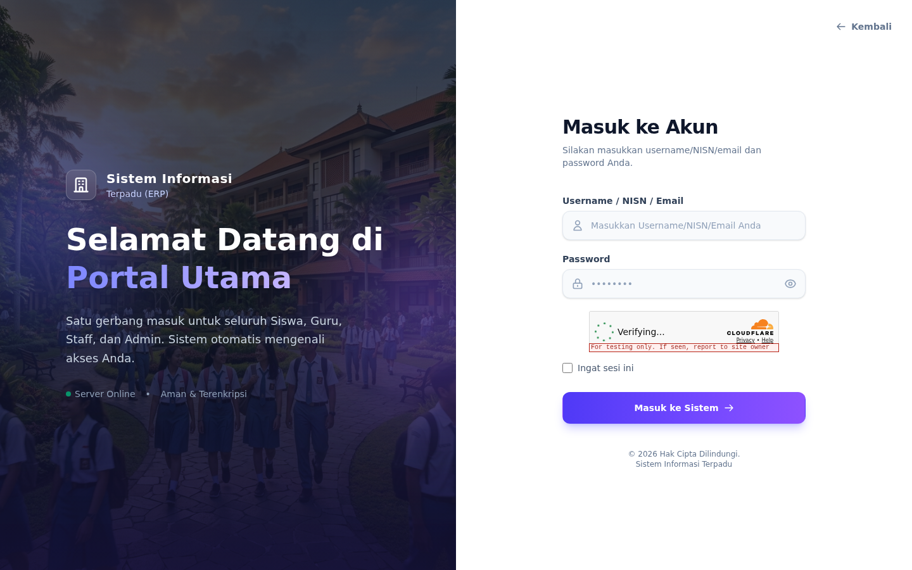
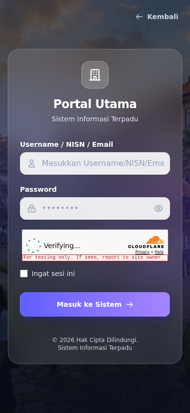

# 📖 Bab 00: Pendahuluan, Cara Login & Pilih Portal

Bab ini membahas langkah paling awal untuk masuk ke sistem **Smart School ERP & Presensi Barcode** melalui halaman login terpadu (`/login`) dan memilih portal kerja di layar `/pilih-portal`.

---

## 1. Alur Masuk ke Sistem

```text
Buka URL Sekolah (/login)
   └──► Isi Username (Email / NIP / NISN / Nama) & Password
           └──► Selesaikan Verifikasi Keamanan
                   ├──► Jika akun hanya punya 1 portal ──► Langsung masuk ke portal tersebut
                   └──► Jika akun punya beberapa portal  ──► Tampil layar Pilih Portal (/pilih-portal)
```

> [!TIP]
> Aplikasi mendukung tampilan **Web (Desktop/Laptop)** maupun **HP (Smartphone)** secara responsif. Di bawah ini disertakan contoh tampilan kedua mode tersebut.

---

## 2. Halaman Login Terpadu (`/login`)

- **Alamat URL**: `http://10.66.66.14:8001/login`
- **Siapa yang bisa masuk**: Semua pengguna (*Super Admin, Admin Modul, Guru/GTK, Petugas Presensi, Pustakawan, dan Siswa*).

### Langkah-langkah Login:
1. Buka alamat `/login` melalui browser di laptop/PC maupun HP.
2. Pada kolom **Username / NISN / Email**, masukkan salah satu identitas akun Anda:
   - **Super Admin / Admin**: alamat email akun admin (contoh: `admin@smpn1majenang.sch.id`).
   - **Guru / GTK**: email login, NIP, atau prefix username.
   - **Siswa**: NISN siswa atau email login siswa (contoh: `0013260001`).
3. Masukkan **Password** akun Anda.
4. Centang **Ingat sesi ini** (*opsional*) bila memakai perangkat pribadi.
5. Selesaikan verifikasi keamanan pada formulir (*widget keamanan Turnstile atau pertanyaan hitung angka*).
6. Klik tombol **Masuk ke Sistem**.

### Tampilan Halaman Login

| 🖥️ Mode Web (Desktop `1440×900`) | 📱 Mode HP (Mobile `390×844`) |
| :---: | :---: |
|  |  |

---

## 3. Layar Hub Pilih Portal (`/pilih-portal`)

- **Alamat URL**: `http://10.66.66.14:8001/pilih-portal`
- Setelah login berhasil, pengguna yang memiliki lebih dari satu hak akses (misalnya *Super Admin* atau *Guru merangkap Admin/Wali Kelas*) akan diarahkan ke layar **Pilih Portal**.

### Daftar Kartu Portal yang Tersedia:
1. **Beranda (`/`)**: Menuju halaman depan website publik sekolah.
2. **Portal Setup & Instalasi (`/portal-setup`)**: Pengaturan pondasi awal sekolah, tahun ajaran, kelas, jabatan, dan mata pelajaran. *(Selalu terbuka untuk `super_admin` / `admin_portal_setup`)*.
3. **Portal Sistem (`/portal-sistem`)**: Manajemen akun pengguna, hak akses portal, gateway & notifikasi WhatsApp, mode maintenance, serta tema warna.
4. **Portal Akademik (`/portal-akademik`)**: Data Guru, Siswa, Kelas & Pembelajaran, Rombel, Kenaikan/Kelulusan, Supervisi Jurnal Mengajar, SI-WALI, dan Ekstrakurikuler.
5. **Portal Presensi (`/portal-presensi`)**: Kiosk scanner gerbang, input manual, ijin, sholat dhuhur/jumat, ekstrakurikuler, jam kerja, dan rekap presensi.
6. **Portal Guru (`/portal-guru`)**: Cockpit kerja harian guru, presensi kelas, Jurnal Mengajar KBM, bimbingan SI-WALI, BK, dan SPIKAP.
7. **Portal Perpustakaan (`/portal-perpustakaan`)**: Katalog buku, eksemplar barcode, kiosk pengunjung, dan sirkulasi peminjaman.
8. **Portal Web (`/portal-web`)**: Pengelolaan berita/artikel, pengumuman, prestasi, galeri foto, layanan publik, dan direktori alumni.
9. **Portal Siswa (`/portal-siswa`)**: Khusus akun siswa (kartu pelajar digital, riwayat presensi, pengajuan ijin, konsultasi Guru Wali, SPIKAP, dan perpustakaan).
10. **Keluar**: Mengakhiri sesi login dengan aman.

> [!IMPORTANT]
> **Status Portal Terkunci Sebelum Setup**: Apabila **Identitas Sekolah** (*Nama Sekolah & Alamat*) di `/portal-setup/dasar` belum pernah disimpan, portal operasional selain **Portal Setup** dan **Portal Sistem** akan tampil berlabel **`Terkunci`**. Silakan lanjut ke **[Bab 01: Portal Setup (`/portal-setup`)](01-portal-setup.md)** untuk membukanya.

### Tampilan Hub Pilih Portal

| 🖥️ Mode Web (Desktop) | 📱 Mode HP (Mobile) |
| :---: | :---: |
|  |  |

---

## 4. Navigasi Selanjutnya
- 👉 Lanjutkan ke **[Bab 01: Setup & Instalasi Awal (`/portal-setup`)](01-portal-setup.md)** atau buka versi interaktif **[Buku Panduan Web HTML](index.html)**.
